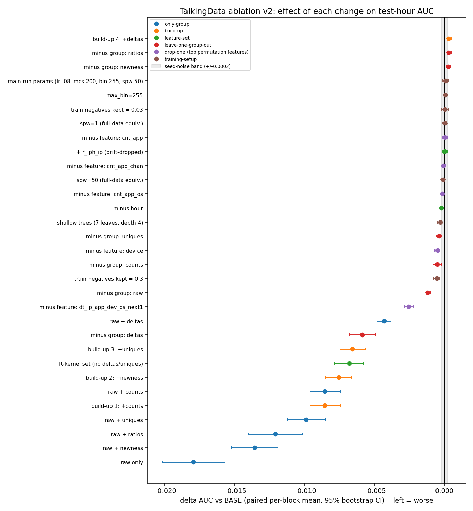
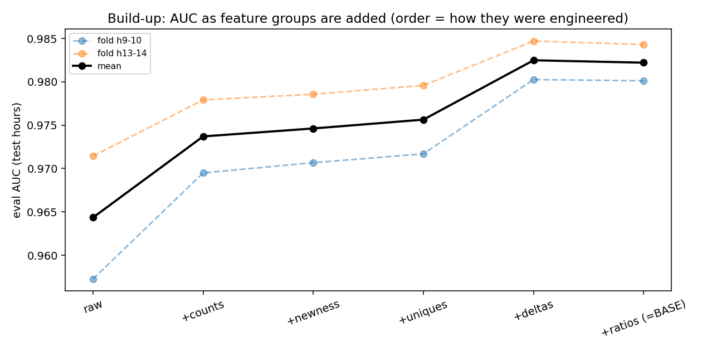
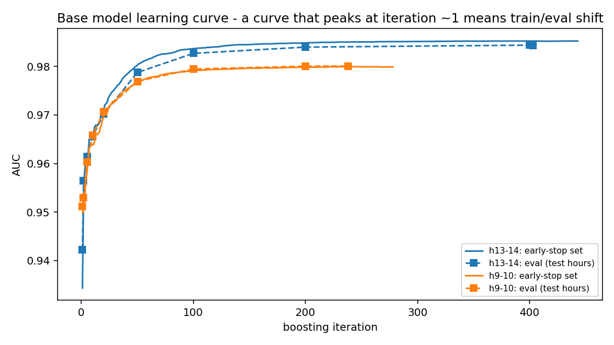
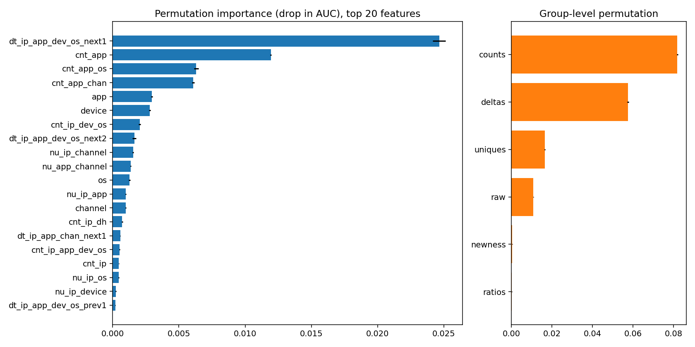

# TalkingData AdTracking Fraud Detection

> **Headline finding:** time-delta features add ~0.006 AUC (more than any tuning); hyperparameters are within noise; newness and ratio features add almost nothing.

**Context:** In the 2018 Kaggle [TalkingData AdTracking Fraud Detection Challenge](https://www.kaggle.com/competitions/talkingdata-adtracking-fraud-detection), my original R-based ensemble placed 263rd out of 3,943 teams (Bronze Medal).

Like many Kaggle solutions, my original final submission was a bit of a Frankenstein: a manual, post-hoc average of several different prediction files. I put together this repository to upgrade that old work into a proper, reproducible pipeline. The goal was to replace the manual blending process with a single script that goes straight from raw data to the final submission, handling memory constraints, chronological splits, and model ensembling automatically.

This explains the slight difference in the private score (0.98206 original vs. 0.98006 here). I traded a tiny bit of leaderboard performance for a strict, end-to-end automated setup.

## Pipeline Overview

Run `python main.py` to execute the whole thing. It does the following:

| Step | What it does |
|---|---|
| **1. Data** | Loads the last 40M rows of `train.csv`. To prevent target leakage, validation is strictly chronological (the newest 2.5M rows are held out). No random splits. |
| **2. Features** | Builds R-kernel group counts, 1/2/3-step forward/backward time deltas, and `nunique` counts. Test features are built over `test_supplement` so the train and test stats share the full test-day context. |
| **3. Drift filter** | Runs a label-free adversarial validation scan (300k samples). Using `test_supplement` lowered the mean drift AUC to 0.5634. Only one feature (`r_iph_ip`) drifted above the 0.70 threshold and was dropped. |
| **4. Models** | Trains `lgbm_full` (LightGBM), `ftrl` (Numba FM-FTRL on hashed 2/3-way crosses), and `nn` (multi-seed PyTorch embedding MLP). |
| **5. Blend** | Evaluates a 5-fold time-blocked rank average. For this run, the auto-blender found that the PyTorch NN outperformed the rest enough that it just selected `single:nn` (100% weight, 0.99048 pooled OOF AUC). |
| **6. Tails** | Searches for floor/ceiling truncation percentiles. This was dynamically skipped during the run because no truncation threshold improved the validation AUC. |
| **7. Outputs** | Writes `submission.csv` alongside diagnostic logs (`final_report.json`, `nn_seed_aucs.json`, etc.) in the `outputs/` folder. |

*The feature ablation is a separate script, see [Ablation Study](#ablation-study-which-features-actually-matter).*

## Leaderboard Results

| Submission | Val AUC | Public AUC | Private AUC | Notes |
|---|---|---|---|---|
| Original 2018 submission | — | **0.98122** | **0.98206** | Bronze Medal entry. Generated from a manual post-hoc blend. |
| This repo (`submission.csv`) | **0.99048** | **0.97921** | **0.98006** | End-to-end pipeline. The automated ensembler selected the NN. |

*Note on the validation gap:* The final 2.5M chronological validation rows fell entirely outside the competition's `TEST_HOURS = (4, 5, 9, 10, 13, 14)`. This explains the drop from the 0.99048 validation AUC to the 0.98006 private LB.

## Ablation Study: Which Features Actually Matter?

The ablation is a standalone script, `td_ablation_v2.py`, that uses the same feature code and the same last-40M-row window as the main run (it re-uses a compatible feature cache if found, otherwise builds its own). Its report lives in `ablation_v2/` (`ablation_v2_report.md`, `ablation_v2_results.csv`, plots).

**Why a v2:** my first ablation was invalid. 10 of 11 variants early-stopped at iteration 1 (single-tree models), and the validation window contained no test hours. v2 fixes both and adds proper statistics.

**Protocol**
- **Window:** the same last 40M rows as the main run.
- **Folds:** forward-chained on *test-hour* blocks, one fold per block, so only earlier rows are used for training. Fold 1 evaluates hours 9–10, fold 2 hours 13–14 (about 17k positives each).
- **Early stopping:** on the last 12% of the pre-eval period (immediately before the eval block). Train, early-stop and eval rows never overlap.
- **Sampling:** train keeps all positives + 10% of negatives; early-stop/eval keep 30% (AUC is unbiased under uniform negative subsampling).
- **Calibration:** the base LightGBM config was chosen on early-stop AUC only, and any model stopping before iteration 25 is flagged. None were: every model trained for 160–500 rounds.
- **Statistics:** paired per-block ΔAUC (12 time blocks per fold) with a 95% bootstrap CI. A change counts only if the CI excludes 0 **and** |Δ| exceeds the seed-noise floor (0.00024, from 3 seeds).

**Base model:** 49 features, eval AUC **0.9822** (mean of the two folds).

### Feature groups (leave-one-group-out)

| Removed group | ΔAUC | Verdict |
|---|---|---|
| deltas (18 features) | **−0.0059** | helps a lot |
| raw (5) | −0.0012 | helps |
| counts (12) | −0.0005 | helps |
| uniques (7) | −0.0004 | helps |
| newness (4) | +0.0003 | removing is slightly *better* |
| ratios (3) | +0.0003 | removing is slightly *better* |


*Points left of the grey seed-noise band hurt AUC. "build-up 4" = all groups except ratios (identical to "minus group: ratios").*


*AUC as feature groups are added, per fold. Both folds move together; the jump comes from the delta features.*

### Other findings

- **Time deltas are the single biggest lever.** `dt_ip_app_dev_os_next1` alone is worth −0.0025 AUC when dropped, and is the top permutation-importance feature (0.025 AUC drop).
- **Deltas vs. the R-kernel set:** the original R-style feature set (no deltas, no uniques) scores −0.0068 AUC below the full set. That gap is about 28× the seed-noise floor.
- **Build-up:** raw features alone reach 0.9644; adding counts → newness → uniques gets to 0.9756; adding deltas brings it to 0.9825 (the final ratios step slightly lowers it to 0.9822).
- **Tuning barely matters:** `scale_pos_weight` (1/10/50), `max_bin`, and the original main-run params are all within noise (|Δ| ≈ 0.0001 or less). Shallow trees (7 leaves) cost −0.0003.
- **`hour`:** removing it costs −0.0002, below the noise floor. The drift-dropped `r_iph_ip` changes nothing (+0.00002), consistent with dropping it.
- **Negative subsampling is safe:** keeping 3% vs. 10% of negatives is indistinguishable (Δ +0.00005), and 30% is slightly worse (−0.0005), so the 10% used for the ablation is not distorting the conclusions.

### Health check and importance


*Healthy training: AUC plateaus around 200 rounds and the test-hour eval tracks the early-stop set (no train/eval shift).*


*Permutation importance measures how much the trained model relies on a feature; leave-one-out retraining measures whether it is necessary. They disagree for counts (largest permutation drop, but only −0.0005 when retrained without them) because the count features are largely redundant with each other.*

### Takeaways

1. The gains come from **feature engineering, not tuning**: the time-delta features add roughly 0.006 AUC, more than any hyperparameter change tested.
2. **Newness and ratio features add almost nothing** (removing either gives about +0.0003, just above the 0.00024 noise floor, so the effect is real but tiny). They are candidates for pruning. I have not yet retrained the final model without them, so the main pipeline still includes them.

### Limitations

- The ablation covers a single day, so day-to-day drift and `hour` (whose values are unseen under forward-chaining but seen at test time) can't be fully validated.
- Features are computed over the whole window, as in the main pipeline.
- Ablation uses LightGBM only; conclusions may differ for the NN that the final blend selected.
- Absolute AUCs for the negative-fraction rows come from the last fold only, so only their deltas are comparable to the base.

The ablation was run on Kaggle CPU; it is resumable (finished models are skipped on re-run).

If your feature cache is not in `/kaggle/temp/td_cache` or `/tmp/td_cache`, set `TD_CACHE=/path/to/cache`. Locally the script writes to `outputs/ablation_v2/`; copy the report, CSVs and PNGs into the committed `ablation_v2/` folder.

```bash
python td_ablation_v2.py                      # full: 2 folds, 3 seeds (re-uses a compatible feature cache if present)
TD_ABL_QUICK=1 python td_ablation_v2.py       # quick: 1 fold, 2 seeds
```

## Repository layout

- `main.py`: end-to-end pipeline
- `td_ablation_v2.py`: feature/parameter ablation
- `ablation_v2/`: ablation report, CSVs, plots
- `original_2018_r/`: original 2018 R code (Bronze Medal entry)
- `logs/main_run.log`: log of the main run
- `kernel-metadata.json`, `requirements.txt`: Kaggle/run metadata and dependencies

## Credits & References
- **Competition:** [TalkingData AdTracking Fraud Detection (2018)](https://www.kaggle.com/competitions/talkingdata-adtracking-fraud-detection)
- **R features & params:** Modified from Pranav Pandya's [Single LightGBM in R](https://www.kaggle.com/code/pranav84/single-lightgbm-in-r-with-75-mln-rows-lb-0-9690).
- **Time-delta features:** Inspired by Krishna's LGBM with time deltas ([Discussion #54171](https://www.kaggle.com/competitions/talkingdata-adtracking-fraud-detection/discussion/54171)).
- **FM-FTRL params:** Antti Puurula's [TalkingData Wordbatch FM_FTRL](https://www.kaggle.com/code/anttip/talkingdata-wordbatch-fm-ftrl-lb-0-9769) and [Wordbatch GitHub](https://github.com/anttttti/Wordbatch). Re-implemented here in pure Numba to drop C++ dependencies.

## How to Run

**1. Get the data:**
```bash
kaggle competitions download -c talkingdata-adtracking-fraud-detection
unzip talkingdata-adtracking-fraud-detection.zip -d data/
```

**2. Run the script:**
```bash
pip install -r requirements.txt
python main.py
```

**3. (Optional) Run the ablation:**
```bash
python td_ablation_v2.py
```

*Runtime note*: This pipeline is engineered to execute end-to-end on a standard Kaggle CPU Kernel (4 Intel Xeon vCPUs, 30GB RAM) in approximately 60–90 minutes. By combining multi-threaded Numba/LightGBM execution, atomic .npy memory-mapping, and chunked inference, it processes 40M+ training rows and full test-day supplements cleanly without hitting container out-of-memory (OOM) limits.
